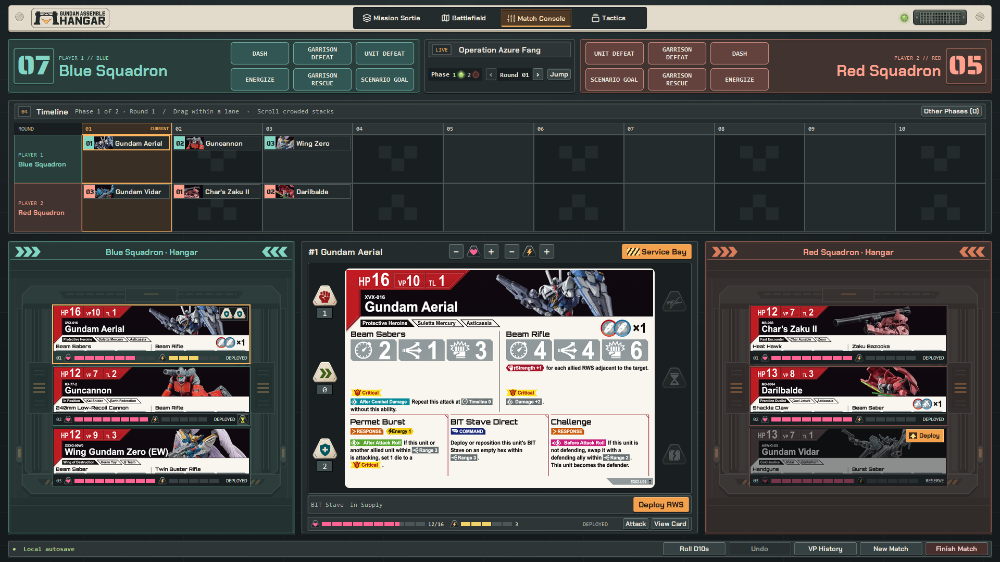
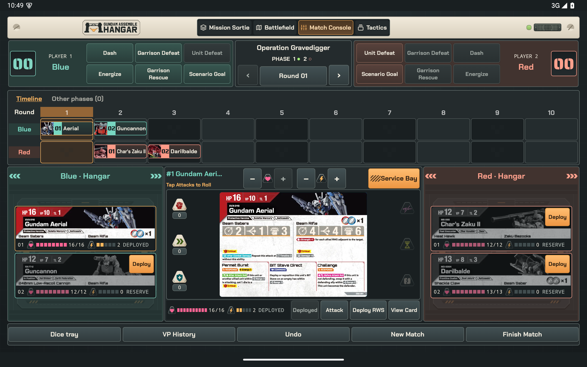
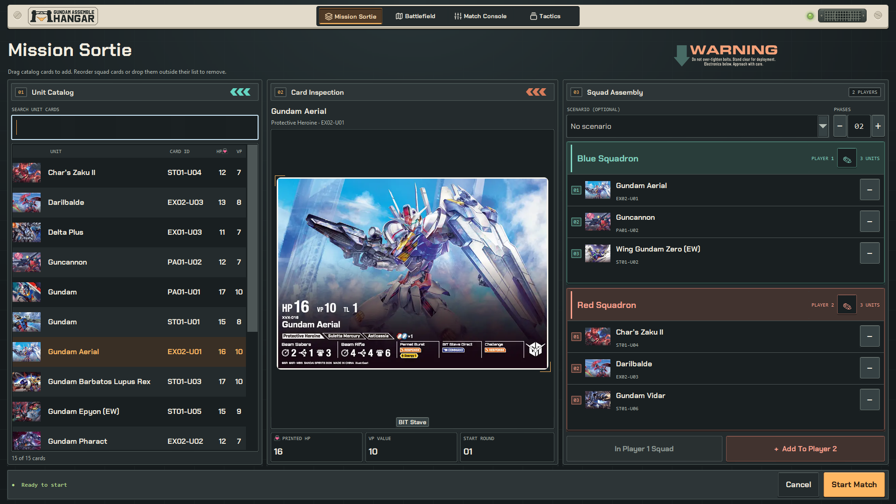
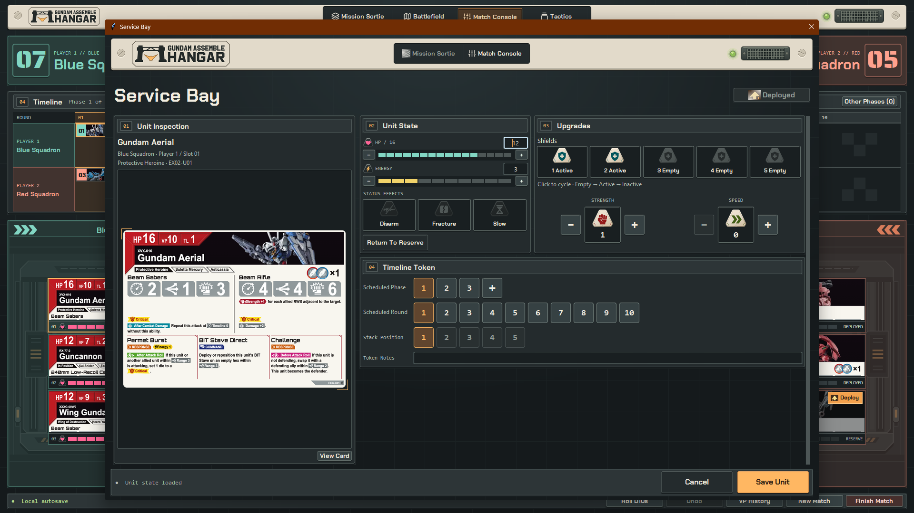
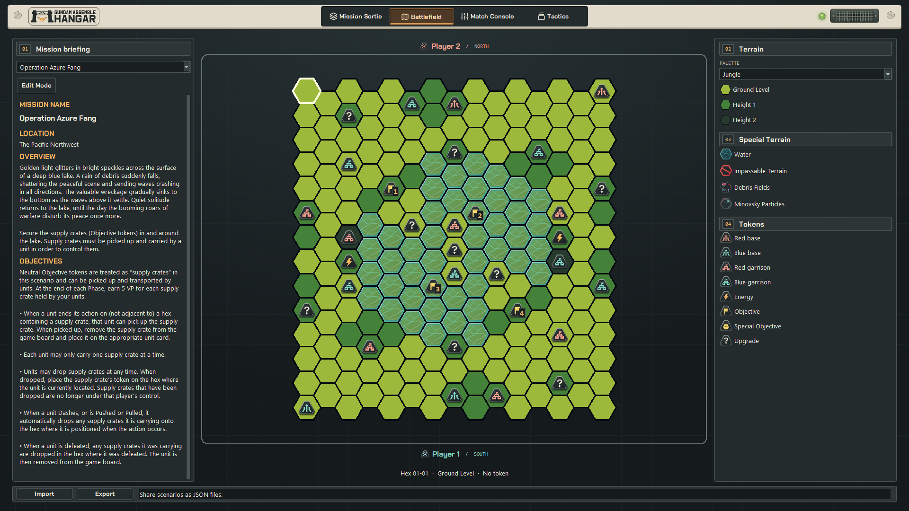

# Gundam Assemble Hangar

An unofficial companion for playing **Gundam Assemble with physical miniatures**. Assemble squads, set up the battlefield, track both players' units and Victory Points, and roll attacks together on a laptop, touch PC, or landscape Android tablet. Cards, scenarios, dice, and saves work offline.

**[Download v1.3.0](https://github.com/Peacecraftian/Gundam-Assemble-Hangar/releases/tag/v1.3.0)** · [Windows](#windows) · [Android](#android) · [Playing a match](#playing-a-match) · [Build from source](docs/DEVELOPMENT.md)

## Install and play

### Windows

Download **Gundam-Assemble-Hangar-v1.3.0-Windows-x64.zip**, choose **Extract All**, and open **Gundam-Station/Launcher/Hangar.Launcher.exe**. Tap **Enter Hangar** to launch fullscreen. The ZIP includes the terminal launcher, game, required runtimes, and three local rules PDFs.

Either header screw toggles Hangar fullscreen. **Esc** restores window mode. Close Hangar to return to the terminal, or use **Maintenance → Return to desktop** to leave the launcher. The included README explains optional startup at Windows sign-in.

Station saves live in **Gundam-Station/Data**. When updating, close both programs, extract the new package into a new folder, and copy your existing **Data** folder into it. Keep the whole station folder together.

### Android

Download **Gundam-Assemble-Hangar-v1.3.0-Android.apk** on your tablet and open it. If Android asks, allow installation from the browser or file manager you used. The APK supports Android 7.0 or later on ARM64 and x86-64 devices and opens in landscape.

Android has Mission Sortie, Battlefield, Match Console, Service Bay, and Tactics browsing. Saves belong to that installation. Keep the app installed to retain your match and custom scenarios when updating. Windows and Android maintain separate local matches.

This is the first publicly packaged Android build. It has been checked on an Android 15 landscape tablet emulator. Physical-device feedback is welcome. Earlier development APKs use a different signing key, so installing this release over one may require removing the development app and its local data.

## Playing a match

1. In **Mission Sortie**, enter player names, choose an optional scenario, and assemble both squads from published cards. Full-art variants appear during selection. Drag units into the Windows squads and reorder their slots. Duplicate cards are permitted for Mass Produced units.
2. Open **Battlefield** for the selected scenario's map, mission briefing, terrain and token placements.
3. Return to **Match Console** and deploy units as their activations arrive. Both VP totals, Timeline lanes and Hangars stay visible. Drag Timeline tokens between rounds, use **Other Phases** for later activations, and open **Service Bay** for exact scheduling and stack order.
4. Use the action buttons beside the acting player's VP total. Tap the VP number for a manual adjustment. **VP History** shows recorded awards, and **Finish Match** handles final totals and the last-to-act tiebreaker.

The app autosaves edits and keeps the last 20 Undo entries across restarts. Starting a replacement match asks for confirmation.

## Built for touch at the table

- Larger, player-colored action buttons and portrait target selectors make units easier to identify.
- HP and Energy bars appear in the Hangars and highlighted card. Use the card header's **− / +** controls for adjustments.
- Tap Strength, Speed, and Shield upgrade icons to increase their counts, cycling back to zero after eight. Status icons toggle Disarm, Fracture, and Slow.
- **Service Bay** provides larger upgrade controls, individual Shield states, and tap choices for Phase, round and stack position.
- Windows text fields open an on-screen keyboard for player names, searches and notes. Android uses its system keyboard.
- Tactics supports touch scrolling and card inspection. On Windows, double-tap the enlarged card artwork to close it.

## Attacks and actions

Tap a weapon's stat strip or **Attack**, choose an enemy unit or Garrison, and enter applicable Strength and Accuracy modifiers. **Declare & Roll** pays the printed weapon TL before rolling. Select individual dice for **Reroll Selected**, then review and **Apply Damage**.

The damage preview accounts for active Shields and Fracture. Resolve Disarm after other After Attack Roll abilities. Wing Zero's Zero System recognizes natural 7–10 as criticals, and its Twin Buster Rifle adds the appropriate critical damage bonus. Defeated units award VP, return to Reserve, advance 2 TL, recover HP, and clear statuses while keeping Energy and Upgrades.

Closing the tray preserves the declared attack and settled dice. Reopen **Attack** to resume. One **Undo** reverses the declaration and its results. Making a different match edit while the tray is closed ends the suspended attack with its TL paid.

| Action | What Hangar records |
| --- | --- |
| Dash | Advances the acting unit 2 TL. |
| Energize | Grants 1 Energy and advances the unit 2 TL. |
| Garrison Rescue | Awards 2 VP and advances the rescuer 2 TL. |
| Garrison attack | Uses the weapon's TL and defeats the 1-HP target for 2 VP if damage gets through. |
| Garrison Defeat shortcut | Records a tabletop result. Enter only unpaid TL, defaulting to zero. |
| Scenario Goal | Records the VP award you enter. |
| Blocked deployment | Grants 1 Energy and advances 2 TL while staying in Reserve, when both deployment and a legal Advance are impossible. |

Players judge range, line of sight, terrain, movement and other card effects at the table. Area attacks currently resolve against one target per attack dialog. Extra attacks and altered TL costs require manual bookkeeping. **Roll D10s** provides a free dice tray. Remote Weapon Systems have their own deployment, HP and defeat controls.

## Battlefield and custom scenarios

The bundled scenarios are **Operation Sleeping Leviathan**, **Operation Azure Fang**, **Operation Lockdown**, and **Operation Gravedigger**. The selected scenario reopens with your match.

Choose **New Scenario** or **Edit Mode** to paint elevation and Special Terrain, place tokens, and write the briefing. Terrain brushes support strokes with Undo and Redo. Water, Impassable Terrain, Debris Fields and Minovsky Particles sit above elevation, with their rules available when inspecting a hex. Objective flags number themselves in placement order.

Five palettes include Desert, Jungle, Urban, Underwater and Space, with sparse stars on Space ground tiles. Save custom scenarios locally or use **Import / Export** to share their JSON files. Editing an official scenario creates a custom copy.

## Tactics

Search published Tactics Cards by name or card number and open a readable full-card view. Use physical decks and resolve card effects at the table.

## About the project

Hangar is an unofficial fan-made companion and is not affiliated with or endorsed by the owners of Gundam or Gundam Assemble. The [MIT License](LICENSE) applies only to Hangar’s original source code.

Official artwork, card images, rules, scenario text, names, logos, and other game material remain the property of their respective owners and are not covered by Hangar’s MIT license. Including or adapting these materials does not transfer ownership or grant permission to reuse or redistribute them. Third-party software, fonts, and icons retain their own licenses. See the [license and asset notices](NOTICE.md) for details, and the [development guide](docs/DEVELOPMENT.md) for source setup and builds.
