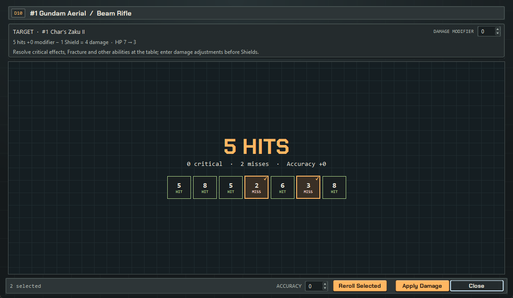
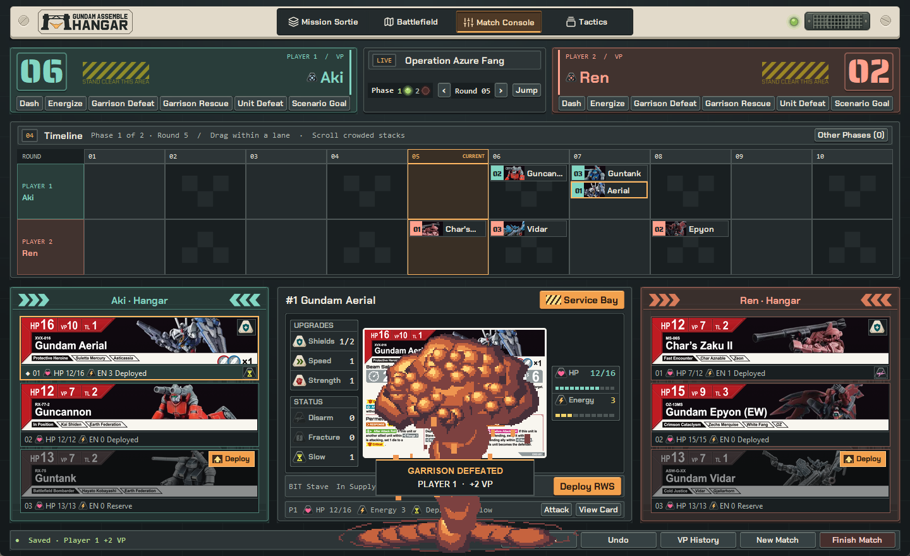
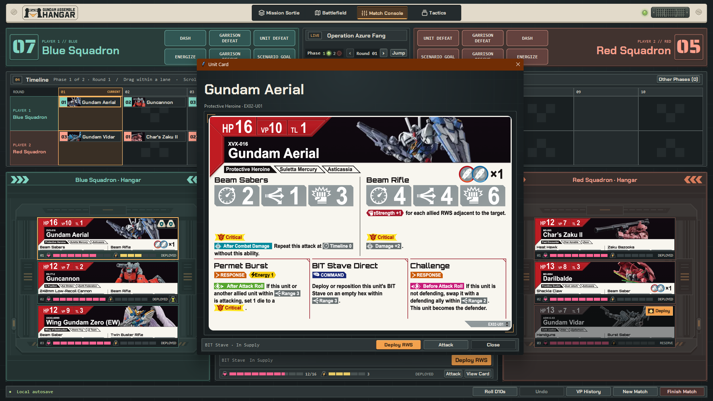
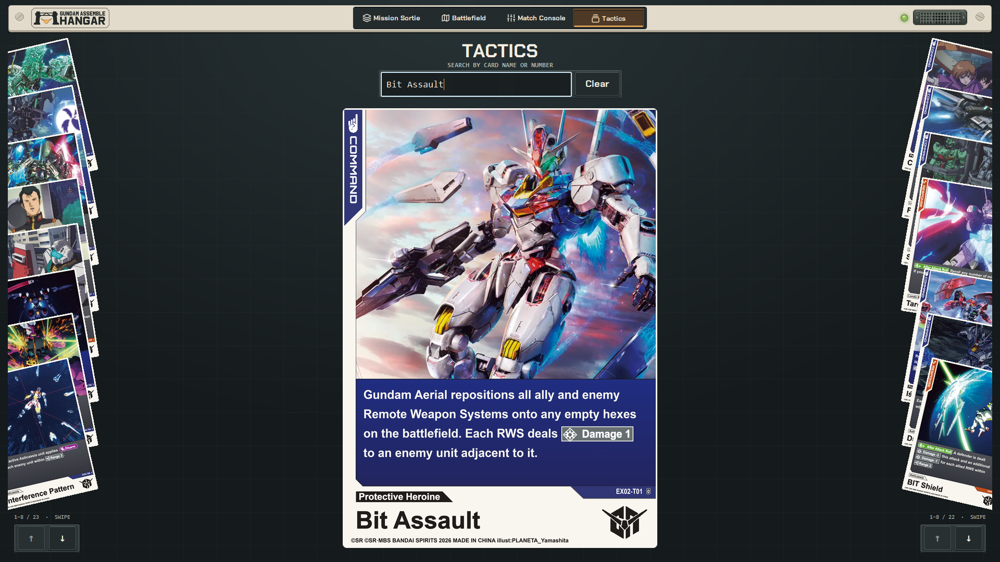

# Gundam Assemble Hangar

**Your shared command console for the Gundam Assemble table.** Build squads, prepare the battlefield, track both players’ units, and resolve attack rolls on one screen. An offline Windows companion for playing with physical miniatures and cards—at a laptop or on a fullscreen tabletop display.

**[Download the Windows ZIP](https://github.com/Peacecraftian/Gundam-Assemble-Hangar/releases/latest)** · [Get started](#get-started) · [Mission Sortie](#mission-sortie) · [Battlefield](#battlefield) · [Match Console](#match-console) · [Tactics](#tactics)

## Get started

1. **Extract and launch.** Download the Windows x64 ZIP, extract it, and open **Gundam Assemble Hangar.exe**. Keep the EXE and its `_internal` folder together. No Python or Node installation is needed.
2. **Assemble your squads.** Open **Mission Sortie**, name the players, choose a scenario if desired, and add published Unit Cards. Start the match, then use **Battlefield** to arrange the physical board.
3. **Deploy and play.** Click **Deploy** in a unit’s Hangar when its miniature enters play. Use **Match Console** for bookkeeping and **Tactics** to look up cards. Either header screw toggles fullscreen; **Esc** exits it on the current monitor.

Hangar resumes your last match and retains the last 20 saved edits for **Undo**, even after restarting. Saves live at `%LOCALAPPDATA%\Gundam Assemble Companion\match.sqlite3`. Starting a replacement match requires confirmation.

## Mission Sortie

Search the catalog by name or card number. Drag a card into either squad at the amber insertion line, or use **Add To Player 1 / 2**. Drag squad rows to reorder them; slot numbers and Hangar order follow your lineup. Remove a row with **−** or drag it outside the list. Duplicate cards are allowed only for **Mass Produced** units.

Choose a bundled or custom scenario, or **No scenario** to track a match independently. Set the Phase count, then click **Start Match**. Units begin in Reserve at their printed Timeline positions.

## Battlefield

Set up **Operation Sleeping Leviathan**, **Operation Azure Fang**, **Operation Lockdown**, or a custom scenario using the mission briefing and the 203-hex board. Terrain colors show elevation; Special Terrain decals and gameplay tokens layer above it. Select a hex to inspect its contents and associated Special Terrain rules. The scenario chosen in Mission Sortie follows the match when you resume it.

Preview five environments—**Desert, Jungle, Space, Urban, and Underwater**—with Ground Level, Height 1, and Height 2 colors. Each scenario loads its saved palette.

### Create and share scenarios

- Choose **New Scenario** for a blank board, or **Edit Mode** to revise a scenario’s name, location, overview, objectives, and layout.
- Click-and-drag an elevation brush to paint terrain. Right-drag resets it to Ground Level. **Water, Impassable Terrain, Debris Fields, and Minovsky Particles** use a separate overlay layer; right-drag with one of these brushes erases that layer.
- Place gameplay tokens with individual clicks; right-click with a token brush to remove them. Objective flags number themselves 1–4 in placement order. **Undo / Redo** treats each brush stroke or token edit as one action.
- **Save** keeps your custom scenario and palette locally. Editing a bundled scenario creates a custom copy; only custom scenarios can be deleted. **Export / Import** shares the briefing, palette, terrain, and tokens in one JSON file.

## Match Console

### Timeline and unit state

Use the **Round** arrows to advance or rewind; crossing Round 10 advances the Phase. **Jump** selects a Phase and Round directly. Drag portrait trackers within a player’s lane to move units or reorder a stack. **Other Phases** lists units outside the current Phase.

Click a Hangar card or tracker to inspect the unit in the center:

- **HP, Energy, Speed, Strength:** left-click adds one; right-click subtracts one.
- **Statuses:** left-click applies, right-click clears. Clicking a status badge in the Hangar also clears it.
- **Shields:** left-click reactivates inactive Shields, or adds one if none are inactive and a slot is free. Right-click spends an active Shield.

Double-click a Hangar card or tracker, or open **Service Bay**, for detailed edits, individual Shield slots, Timeline placement, notes, and **Return To Reserve**. Confirm with **Save Unit**. **View Card** opens the full card.

### Attack rolls and selective rerolls

1. Select a deployed unit and click a weapon’s stat strip, or **Attack**. Choose a deployed enemy from the portrait lineup. Strength Upgrades are prefilled; enter any other Strength and Accuracy modifiers.
2. Roll the D10 pool. For abilities that allow rerolls, click the relevant results and **Reroll Selected**. Unselected dice stay intact, and hit/critical totals update.
3. Enter any **Damage Modifier**, review the preview, then **Apply Damage**. Active Shields absorb damage and deactivate before HP is reduced. Lethal damage triggers the Unit Defeat workflow below, including its animation. The entire resolution is one **Undo** action.

HP stays unchanged until **Apply Damage**; closing the tray discards an unapplied roll. Resolve critical effects, Fracture, other abilities, range, line of sight, and the attacker’s Timeline cost at the table. Enter net damage adjustments before Shields. **Roll D10s** in the footer provides free rolls of up to 60 dice without applying damage.

### Actions and scoring

Use the buttons **under the acting player’s VP total**. Dash, Energize, and Garrison actions list that player’s deployed units and preselect the highlighted unit when eligible. Unit Defeat lists deployed opponents and their Remote Weapon Systems. Portraits and squad numbers distinguish copies.

| Action | What Hangar records |
| --- | --- |
| **Dash** | Advances the unit two Timeline spaces; move the miniature at the table. |
| **Energize** | Adds 1 Energy and advances the unit two Timeline spaces. |
| **Garrison Defeat / Rescue** | Awards the acting player 2 VP and advances the unit two Timeline spaces. |
| **Unit Defeat** | Awards printed VP to the opponent, returns the target to Reserve, advances it two Timeline spaces, restores HP, and clears statuses. Energy and Upgrades remain. |
| **Scenario Goal** | Records the VP award you enter for the scenario. |

Each action is one saved **Undo** step. Click a VP total for a manual adjustment. **VP History** lists awards and reasons; **Finish Match** asks who acted last when scores tie.

Garrison Defeat and Rescue celebrate recorded actions with pixel effects; Energize plays **Reactor Surge**, Dash fires a blue Vernier jet, and positive Scenario Goal awards raise a victory flag with fireworks. Deployment and Unit Defeat also have their own cinematics.

### Remote Weapon Systems

Click an RWS icon on its parent’s card to inspect the system. Use **Deploy RWS** below the central card or in the full **View Card** window when its deployed parent launches it. Track its HP separately; reaching zero returns it to supply and awards its printed VP. Systems can also be selected in **Unit Defeat**. To record a parent and system defeated together, select the parent there and check **Also Defeated**.

## Tactics

Search by printed name or card number, then click a result or press **Enter** to inspect it. Scroll the side fans, hover to spread cards, and click to enlarge one. **Clear** or **Esc** returns it to the fan. Resolve the card’s effects at the table and record any resulting state changes in Match Console.

## About the project

Hangar is an unofficial fan-made companion. Gundam Assemble names, card artwork, and game assets belong to their respective owners. Hangar’s source code is available under the [MIT License](LICENSE). For source setup, builds, asset credits, and scenario bundling, see the [development guide](docs/DEVELOPMENT.md).
